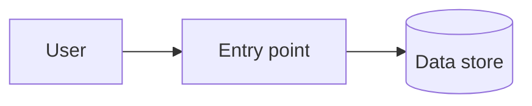

# Architecture: <Project name>

<!-- agent-pack:begin overview -->
<!-- agent-pack: <date> @ <sha> -->
<One paragraph: stack, entry points, data stores, external services.>

<!-- agent-pack:end overview -->

## Modules
<!-- agent-pack:begin modules -->
| Path | Does | Talks to |
|---|---|---|
| `src/…` | | |
<!-- agent-pack:end modules -->

## Where to change X
<!-- agent-pack:begin where -->
| To… | Edit | Tests | Watch out |
|---|---|---|---|
| <add a new API route> | `src/routes/…` | `test/routes/…` | <trap or "none"> |
<!-- agent-pack:end where -->

## External services
<!-- agent-pack:begin services -->
| Service | Used for | Config / binding | Secret lives in |
|---|---|---|---|
<!-- agent-pack:end services -->
